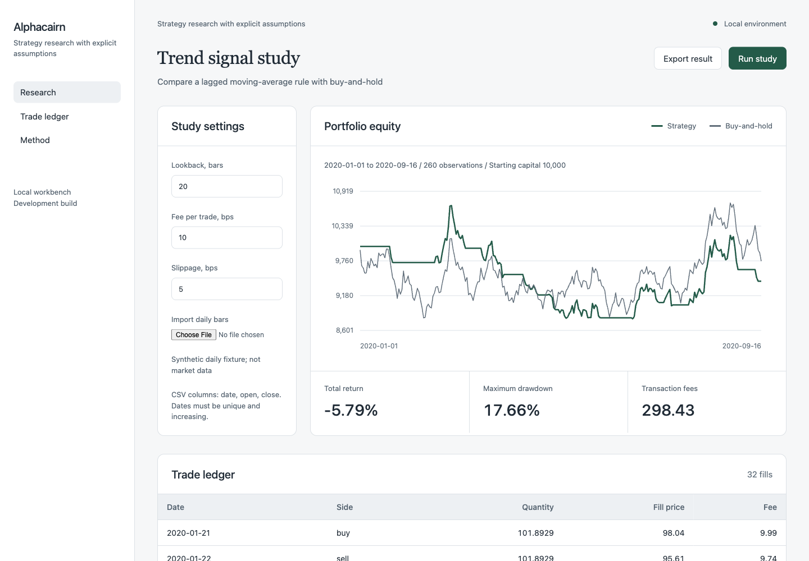
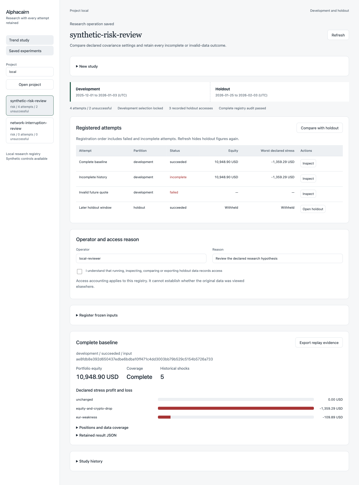
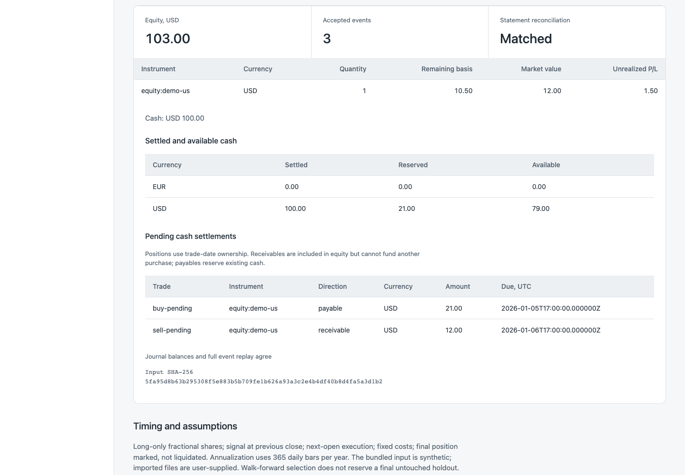
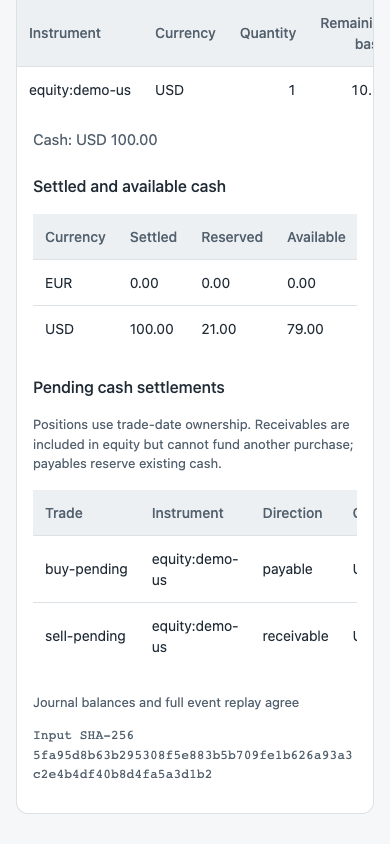

# Alphacairn

Compare trading hypotheses under explicit timing and execution assumptions.
[Quick start](#run-the-workbench) · [Screenshots](#screenshots) · [Guides](docs/README.md) · [Architecture](docs/ARCHITECTURE.md) · [Verification](docs/VERIFICATION.md) · [Contributing](CONTRIBUTING.md)

## Screenshots



A walk-forward example with explicit training windows, fees and a separate baseline. All market data shown here is synthetic. [Guide](docs/RESEARCH.md).

<details>
<summary>More screenshots: saved research, settlement and mobile</summary>

### Saved research and holdout review



Compare successful, incomplete and rejected attempts without discarding their history. [Guide](docs/RESEARCH_WORKBENCH.md).

### Cash settlement



Distinguish portfolio equity, settled cash, reservations and pending settlements in a synthetic example. [Guide](docs/SETTLEMENT.md).

### Mobile settlement review



Review the same settlement controls on a narrow screen; wide tables scroll within their panels. [Guide](docs/SETTLEMENT.md).

</details>

## Run the workbench

From a source checkout with Python 3.10 or later:

```sh
python3 -m venv .venv
. .venv/bin/activate
python -m pip install .
python -m alphacairn.web
```

The build uses setuptools; the application itself has no third-party runtime dependencies.

Open http://127.0.0.1:8412. No third-party runtime packages are required.
Use `--port 0` to choose a free local port, or an explicit port from 1 to 65535. Invalid values are reported as command-line usage errors.
The workbench is a local development application, not a hosted multi-user service. Process-execution controls are qualified on macOS arm64; Windows descendant termination is not qualified.
Bundled examples are included in the wheel. Runtime state is stored outside the installed package.

## Command line

```sh
python3 -m alphacairn examples/synthetic.csv --lookback 20
python3 -m unittest discover -s tests -v
```

## Implemented

Loads validated daily CSV bars, simulates a long-only moving-average signal with previous-close decisions and next-open fills, applies fixed fees and slippage, compares with buy-and-hold and exports the equity path, trade ledger, input hash and assumptions. The browser accepts a local CSV file and exposes the same calculation.

## Portfolio journal

The workbench includes an exact-decimal portfolio section with FIFO lots, quote-currency commissions, splits, explicit dividends, FX cash movements, statement reconciliation and independent event replay. It supports synthetic equity and spot-crypto examples across USD/EUR, including missing-price and statement-difference controls.

For a persistent local account, use `python3 -m alphacairn.portfolio --help`. The [portfolio guide](docs/PORTFOLIO.md) provides the complete example, event contracts, rounding rules, valuation policy and current limits.

## Versioned market data

A local catalog retains original JSON batches, exact decimal OHLCV observations, publication-time revisions and historical universe intervals. Queries require an explicit source and information clock. Portable snapshots can feed the research CLI; decision windows rebuild eligible revisions and membership at each decision time. See [market data guide](docs/MARKET_DATA.md) for commands, timing semantics, limits and a synthetic correction/delisting example.

## Catalog-backed strategy execution

`python3 -m alphacairn.strategy --help` exposes capture, simulation and portable verification of target-inventory studies. Each decision uses its own historical membership and eligible price revisions, while execution prices come from a separately declared realization vintage. Orders use actual prior fills; the explicit scenario is independently replayed through portfolio accounting. The [strategy guide](docs/STRATEGIES.md) includes a complete stock/crypto control, exact cash arithmetic and timing limits.

## Boundaries

The bundled data is synthetic. The simple CSV moving-average backtest models fractional long-only positions, fixed costs and unlimited liquidity; it marks the final position at the last close. The separate multi-instrument execution engine models declared liquidity, partial fills, splits, dividends, opening holdings and cash settlement. Catalog-backed studies use explicit historical universe intervals and price revisions. These inputs are supplied by the operator; official provider feeds, live brokerage, margin, shorting and derivatives are not included. No profitability or market-performance result is claimed.

## Sequential research and risk

```sh
python3 -m alphacairn.research risk examples/synthetic.csv --resample
python3 -m alphacairn.research walk-forward examples/synthetic.csv --train-size 100 --test-size 40
```

The workbench supports fixed parameters and trailing-window selection. Risk reports include stated-frequency annualization, drawdowns, paired baseline diagnostics and historical tail statistics. Window-end liquidation includes costs; a final untouched holdout is not reserved automatically. Dataset hashes normalize date/open/close records; original file or received-text hashes are retained separately. See [research method](docs/RESEARCH.md).

## Installed examples

```sh
python3 -m alphacairn.resources ./demo
```

This exports the reviewed examples to a new directory without overwriting an existing destination. Use the exported paths with the CLI.

## Development scope

[Architecture](docs/ARCHITECTURE.md) explains the current execution path.
[Product scope](docs/PRODUCT_SCOPE.md) describes the broader proposed subsystems.
[Weekly roadmap](docs/proposed-weekly-roadmap.csv) is a planning scenario.
[Tasks](TASKS.md) and [request register](REQUESTS.md) track actual status.

## Questions and updates

Ask setup questions or describe a use case in [project Discussions](https://github.com/Pavel-Shcherbo/alphacairn/discussions/categories/q-a). Include the command you ran, your Python/operating-system version and a small synthetic example. For a reproducible defect, use the [issue templates](https://github.com/Pavel-Shcherbo/alphacairn/issues/new/choose).

Follow [Pavel Shcherbo](https://github.com/Pavel-Shcherbo) for work across these tools. To follow only published versions of this project, use **Watch → Custom → Releases** on GitHub.

## License

[MIT](LICENSE), copyright 2026 Pavel Shcherbo.

## History note

This repository was assembled starting in November 2026. Earlier Git timestamps,
where used, represent reconstructed development stages, not verified original
work in those years. The 2019–2026 roadmap is proposed scope, not a completed-work record.

## Multi-instrument execution

The execution CLI models explicit market/limit orders across instruments and currencies, known liquidity budgets, partial fills, tick-rounded slippage, per-fill fees, IOC/DAY/GTC, deferred cancellations and expiry. Its cash/positions reconcile through the portfolio journal; deterministic bundles include fills, orders, equity and replayable ledger events. See [execution guide](docs/EXECUTION.md) for model assumptions, a hand-calculated synthetic example and complete commands. This engine has no brokerage endpoint.

Retained operator calendars and version-2 session-checked execution: [session guide](docs/SESSIONS.md). Synthetic stock/crypto control: `examples/session-execution.json`.

[Declared splits and cash dividends](docs/CORPORATE_ACTIONS.md): version-3 execution, split-aware working orders/signals, dividend receivables and independently reconciled payment events.

## Multi-asset risk studies

Capture a journal-backed portfolio with explicit quotes and history, inspect concentrations, revalue joint price/FX stresses and calculate descriptive covariance and historical tail diagnostics. Complete and incomplete results retain their inputs and replay offline. See the [risk guide](docs/RISK.md) and `python3 -m alphacairn.risk --help`.

## Frozen research registry

Retain every registered risk or strategy attempt, compare successful and failed results, lock a development selection and track explicit access to a declared holdout. Frozen inputs and one trial’s complete study context export for independent replay. See the [research registry guide](docs/RESEARCH_REGISTRY.md) and `python3 -m alphacairn.studies --help`.

## Saved research experiments

Open [the local saved-experiments page](http://127.0.0.1:8412/research.html) to declare development/holdout windows, register frozen risk or strategy inputs, retain failed attempts, inspect exact stress results and export replay evidence. Explicit holdout access and durable request recovery preserve the study history through refreshes and lost responses. See the [research workbench guide](docs/RESEARCH_WORKBENCH.md) for the workflow, HTTP interface and local limits.

## Opening inventory

Start execution or catalog-backed strategies with declared FIFO lots, acquisition dates and basis instead of fabricated purchases. Version 4 preserves opening market marks separately from book basis; persistent journals and the Portfolio editor accept opening events. See [opening holdings](docs/OPENING_HOLDINGS.md) for the complete examples and independent controls.

## Cash settlement

Version-5 execution/strategy studies distinguish settled funds, purchase reservations and delayed sale proceeds using explicit portable business-day calendars. The journal offers idempotent settlement batches, while Portfolio and risk reports expose pending claims separately. See [cash settlement](docs/SETTLEMENT.md) for complete commands, controls and limits.
